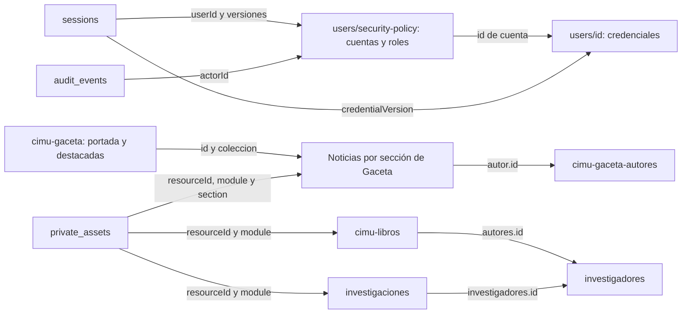

# Base de datos, autenticación y auditoría de CIMU

Guía técnica y operativa · revisión del 28 de octubre de 2026 · rama `update`.

Esta guía describe el código actual del proyecto. No es una exportación de la base de datos ni una comprobación de qué documentos existen en un servidor específico. Los ejemplos son ficticios y abreviados: no deben copiarse sobre documentos reales.

Para una instalación vacía con cuenta inicial y datos de prueba opcionales, consulta [Instalación inicial con Docker](instalacion-inicial.md).

Para conocer las responsabilidades de cada rol, consulta el [manual de roles y permisos](manual-roles-permisos.md). Para migraciones, despliegue y mantenimiento, consulta [Operación de cuentas y permisos](operacion-accesos.md).

Accesos rápidos: [inventario de bases](#2-inventario-de-bases-y-para-qué-sirve-cada-una) · [cuentas y permisos](#3-cuentas-credenciales-y-permisos) · [login](#5-cómo-funciona-el-login-y-el-acceso) · [interpretar actividad](#8-cómo-interpretar-los-logs-de-actividad).

## 1. Cómo leer la estructura de CouchDB

En este proyecto se suele llamar **colección** a cada agrupación de información. En CouchDB estas agrupaciones son **bases de datos**, por ejemplo `users` o `cimu-gaceta-actualidad`. Cada base contiene documentos JSON; un mismo documento puede contener objetos y listas.

| Concepto | Significado y uso |
| --- | --- |
| Base de datos | Agrupa documentos de un dominio, como sesiones o noticias de una sección. |
| Documento | Registro JSON con un identificador `_id`. |
| `_id` | Identificador único dentro de una base. No tiene que ser único entre bases diferentes. |
| `_rev` | Revisión administrada por CouchDB. Al actualizar o eliminar se utiliza la revisión vigente para detectar escrituras simultáneas. Un conflicto suele producir HTTP 409. |
| Referencia | Un campo que apunta al ID de otro documento. CouchDB no comprueba por sí solo que ese destino exista; la aplicación realiza las comprobaciones implementadas. |
| `_design/...` | Documento de diseño de CouchDB; el lector general `allDocs()` lo excluye de los registros de negocio. |
| `_attachments` | Adjuntos binarios de un documento. La API histórica de `articulos` utiliza esta modalidad. Los archivos editoriales privados nuevos se almacenan en disco. |

`_rev` no reemplaza un historial de negocio ni un respaldo. No se deben editar roles, versiones de autenticación o estados editoriales directamente desde CouchDB para resolver tareas habituales: los servicios de la aplicación validan permisos, conflictos e invariantes y generan los eventos correspondientes.

**Tres distinciones fundamentales:**

- `users` es la base de cuentas de la aplicación; no es la base de usuarios del servidor CouchDB llamada `_users`.
- Una cuenta interna permite iniciar sesión. Un perfil de autor o investigador identifica a una persona en las publicaciones públicas. No son intercambiables.
- No existen bases independientes llamadas `roles` o `permissions`. Las reglas de los roles están en `src/lib/security/roles.js`; las asignaciones de cada cuenta están en `users/security-policy`.

## 2. Inventario de bases y para qué sirve cada una

| Base | Qué contiene | Cómo la utiliza el sistema |
| --- | --- | --- |
| `app_meta` | Documento `installation`, versión y estado del primer arranque. | Coordina una instalación nueva o su reanudación; no contiene la contraseña inicial ni define roles. |
| `users` | Política de cuentas y documentos de credenciales. | Login, roles, activación, desactivación y restablecimiento de acceso. Se detalla en la sección 3. |
| `sessions` | Sesiones del navegador identificadas por el hash de un token. | Comprueba identidad, vencimiento y vigencia de las versiones de autenticación en cada solicitud. |
| `auth_attempts` | Contadores temporales de intentos. | Limita login, activaciones y cambios de contraseña en ventanas de 15 minutos. |
| `audit_events` | Eventos de actividad explícitamente registrados por el código. | Consulta de acciones administrativas, editoriales y de autenticación. |
| `private_assets` | Metadatos de archivos editoriales privados. | Relaciona el archivo físico con propietario, módulo, sección y publicación; autoriza su descarga. |
| `cimu-libros` | Documentos de libros y documento especial `colecciones`. | Catálogo público de libros publicados y gestión interna de su proceso editorial. |
| `investigaciones` | Investigaciones y su información editorial. | Gestión interna y consulta pública de investigaciones publicadas. |
| `investigadores` | Perfiles públicos de investigadores y autores del catálogo. | Alimenta perfiles, las referencias de autores de libros y los integrantes de investigaciones. No concede acceso al panel. |
| `cimu-gaceta-autores` | Perfiles de autores de Gaceta. | Firma pública de noticias, foto, biografía, redes sociales y estado del perfil. No contiene las contraseñas del panel. |
| `cimu-gaceta-actualidad` | Noticias de Actualidad. | Guarda el contenido y el estado editorial de esa sección. |
| `cimu-gaceta-vida_universitaria` | Noticias de Vida universitaria. | Mismo modelo editorial, con alcance de permisos por sección. |
| `cimu-gaceta-opinion` | Publicaciones de Opinión. | Mismo modelo editorial. |
| `cimu-gaceta-memoria` | Publicaciones de Memoria. | Mismo modelo editorial. |
| `cimu-gaceta-audiovisuales` | Publicaciones de Audiovisuales. | Mismo modelo editorial; puede incluir enlaces de video. |
| `cimu-gaceta` | Configuración de portada y destacadas. | Sus documentos `publicacion_del_dia` y `publicacion_destacadas` referencian noticias; no duplican su contenido. |
| `carrousel_imagenes` | Registros del carrusel de la página principal. | Gestión de imágenes de inicio mediante `/api/inicio/*`. Es distinto de las destacadas de Gaceta. |
| `articulos` | Documentos y posibles adjuntos del módulo histórico de artículos. | `/api/articulos` tiene acceso interno ligado al módulo libros. No equivale a una sección de Gaceta ni al sistema externo de revistas REMI. |

`initDatabases()` crea las dieciocho bases de esta tabla y los índices indicados más adelante, incluyendo carrusel y artículos históricos. Es idempotente y no crea por sí sola una cuenta. `scripts/bootstrap.js` prepara la cuenta, la configuración y los ejemplos opcionales en una instalación vacía, y registra el proceso en `app_meta/installation`. El arranque de Docker ejecuta ese proceso antes de abrir el servidor.

No se reemplazan documentos o contraseñas existentes. Si encuentra datos anteriores sin política, el inicializador solicita usar la migración. La creación de bases no configura automáticamente documentos de seguridad `_security`; la autorización del panel no sustituye el control de acceso directo al servidor CouchDB.

REMI se consulta como plataforma externa. Este código no implementa una nueva base local de usuarios o de flujo editorial para administrar la plataforma de revistas.

### Relaciones principales



Las flechas representan referencias de la aplicación, no claves foráneas o eliminaciones en cascada de CouchDB. `audit_events.resourceId` es una referencia variable: puede ser una cuenta, publicación, configuración o ruta HTTP, según la acción.

## 3. Cuentas, credenciales y permisos

### 3.1. Documento `users/security-policy`

Es la fuente de verdad de la identidad administrativa de las cuentas.

```json
{
  "_id": "security-policy",
  "_rev": "4-ejemplo",
  "schemaVersion": 1,
  "accounts": {
    "cuenta-editor-demo": {
      "id": "cuenta-editor-demo",
      "email": "editor@example.test",
      "name": "Persona editora",
      "status": "active",
      "authVersion": 3,
      "assignments": [
        { "role": "editor", "modules": ["gaceta"], "sections": ["actualidad"] }
      ],
      "createdBy": "cuenta-admin-demo",
      "createdAt": "2026-10-28T14:00:00.000Z"
    }
  },
  "events": [],
  "updatedAt": "2026-10-28T14:05:00.000Z"
}
```

| Campo | Interpretación |
| --- | --- |
| `accounts` | Mapa de cuentas; la clave coincide con `account.id`. |
| `status` | `invited`: falta establecer contraseña; `active`: habilitada; `disabled`: desactivada. Una cuenta activa también necesita credenciales válidas para entrar. |
| `assignments` | Lista de asignaciones de rol con sus módulos y secciones. |
| `authVersion` | Versión de acceso. Incrementarla invalida lógicamente las sesiones emitidas con una versión anterior. |
| `createdBy`, `createdAt`, `updatedAt` | Autor de la creación y fechas cuando corresponden. |
| `events` | Registro auxiliar limitado a los últimos 100 eventos de creación/actualización de cuentas. Usa `at`, no `createdAt`. No sustituye `audit_events`. |
| `schemaVersion` | Versión del modelo de política; la migración inicial establece `1`. |

Los roles son `administrador`, `director`, `editor`, `colaborador` y `consulta`. Los módulos son `gaceta`, `libros`, `investigaciones`, `investigadores`, `autores` e `inicio`. Las secciones de Gaceta son `actualidad`, `vida_universitaria`, `opinion`, `memoria` y `audiovisuales`; `*` significa todas.

Ejemplo: la asignación anterior permite actuar como editor en Actualidad. No concede publicación directa ni edición de otras secciones. Administración gestiona cuentas y auditoría; para publicar necesita además una asignación editorial adecuada.

El permiso y el alcance deben satisfacerse dentro de una misma asignación. No se toma el rol de una asignación y el módulo de otra para crear un acceso adicional.

Las actualizaciones de política usan `_rev` y reintentan conflictos hasta cinco veces. Así se comprueba la unicidad del correo normalizado y se impide quitar al último administrador activo. El formulario envía `version`, que se compara con `authVersion` para detectar datos desactualizados. Este documento central está pensado para un equipo editorial; no es un sistema de tablas de usuarios independientes a gran escala.

### 3.2. Documento `users/<id-de-cuenta>`

Contiene las credenciales de esa cuenta, separadas de sus roles.

| Campo | Cuándo aparece y para qué sirve |
| --- | --- |
| `_id` | Coincide con el ID de la cuenta en la política. |
| `email` | Puede conservarse en el documento de credenciales; la búsqueda de identidad del login se realiza en la política. |
| `passwordHash` | Hash bcrypt de la contraseña. Las contraseñas nuevas usan coste 12. No se almacena la contraseña en texto. |
| `credentialVersion` | Identificador de la versión de credenciales; debe coincidir con el registrado en la sesión. |
| `setupTokenHash` | SHA-256 del token de invitación o restablecimiento pendiente. |
| `setupExpiresAt` | Vencimiento del enlace pendiente. |

Al consumir correctamente el enlace se guardan `passwordHash` y una nueva `credentialVersion`, y se eliminan `setupTokenHash` y `setupExpiresAt`. `_rev` impide consumir simultáneamente el mismo enlace dos veces.

Los documentos migrados pueden conservar campos históricos como `isAdmin`, nombre o correo. **`isAdmin` ya no autoriza el acceso**: el login y los permisos utilizan la política actual.

Crear un autor público en `cimu-gaceta-autores` o un investigador no crea este par de registros ni envía una invitación de acceso.

## 4. Sesiones e intentos de autenticación

### `sessions`

Una sesión típica tiene esta forma; el hash se representa con un texto ilustrativo:

```json
{
  "_id": "<sha256-del-token-de-sesion>",
  "userId": "cuenta-editor-demo",
  "authVersion": 3,
  "credentialVersion": "version-credencial-demo",
  "createdAt": "2026-10-28T14:00:00.000Z",
  "expiresAt": "2026-10-29T14:00:00.000Z",
  "absoluteExpiresAt": "2026-11-04T14:00:00.000Z"
}
```

- El navegador recibe un token aleatorio de 32 bytes, codificado como 43 caracteres base64url, en la cookie `session`. La base guarda su SHA-256 como `_id`, no el token original.
- La cookie usa `HttpOnly`, `SameSite=Lax`, ruta `/` y `Secure` en producción. El despliegue de producción requiere HTTPS.
- La sesión se emite por 24 horas. Si al validarla quedan menos de 12 horas, se intenta renovarla hasta 24 horas desde ese momento, sin superar siete días desde su creación. No es una actualización exacta en cada clic.
- `createdAt` permanece como fecha del login original; renovar la sesión no convierte el acceso en una sesión recién iniciada para operaciones sensibles.
- Cada petición comprueba que la cuenta esté activa y que coincidan `authVersion` y `credentialVersion`.
- Desactivar una cuenta, cambiar asignaciones, revocar sesiones o cambiar credenciales puede invalidar sesiones aunque sus documentos aún existan físicamente.
- Cerrar sesión elimina la sesión concreta y borra la cookie. No cierra automáticamente todos los demás navegadores.

### `auth_attempts`

Cada documento contiene `_id`, `count` y `expiresAt`. El ID se calcula como SHA-256 de una clave y el número de ventana temporal. No guarda el correo o la IP en un campo legible.

| Operación | Clave lógica | Límite por ventana de 15 minutos |
| --- | --- | --- |
| Login por IP | `ip:<direccion>` | 50 intentos |
| Login por correo normalizado | `email:<correo>` | 10 intentos |
| Activación/restablecimiento | `setup:<direccion>` | 20 intentos |
| Cambio de contraseña | `password:<userId>` | 10 intentos |

Los contadores son persistentes y compartidos entre procesos. También cuentan solicitudes que terminan correctamente. Si el conteo llega al máximo se responde 429. Las ventanas son fijas; el mensaje indica volver a intentar en 15 minutos, pero el reinicio efectivo se produce al comenzar la siguiente ventana.

Estos documentos son contadores, no un listado de cada intento fallido. No permiten reconstruir por sí solos una secuencia de logins.

## 5. Cómo funciona el login y el acceso

### Inicio de sesión, paso a paso

1. La persona abre `/login` y envía correo y contraseña a `POST /api/login`.
2. El middleware identifica la ruta, verifica el origen de las escrituras y valida la estructura de entrada. El endpoint normaliza el correo: elimina espacios externos y lo convierte a minúsculas.
3. Se comprueban los contadores por IP y correo.
4. `authenticateUser()` lee `users/security-policy`, localiza la cuenta por correo y obtiene `users/<id>`.
5. Se compara la contraseña con bcrypt. Para un correo inexistente se usa un hash de comparación ficticio; la respuesta pública no distingue entre correo inexistente, contraseña incorrecta y cuenta no habilitada.
6. Si la autenticación falla, se registra `auth.login_failed` y se devuelve 401, sin sesión nueva.
7. Si es válida y la cuenta está activa, se registra `auth.login`, se crea un documento en `sessions` y se entrega la cookie.
8. La respuesta pública omite las credenciales. El frontend redirige al panel o a una ruta interna `/admin` validada; no utiliza una URL externa libre.

**Matiz de auditoría:** `auth.login` se escribe antes de crear la sesión. Si esa escritura posterior falla, puede existir el evento sin que el navegador haya recibido una sesión. Por tanto, el evento prueba que se superó la autenticación en ese punto, pero no garantiza que se cargara una página del panel.

### Comprobación en las siguientes peticiones

El middleware valida la cookie y coloca la identidad vigente en `locals.user` y la sesión en `locals.session`. Si ya no es válida, elimina la cookie. Las páginas `/admin/*` sin identidad redirigen al login; las API protegidas responden 401 o 403 según el caso.

La autorización tiene dos niveles: la regla de la ruta y las comprobaciones de módulo, sección, propietario, responsable y estado del registro. Ocultar botones en Vue no concede ni revoca permisos: el servidor vuelve a comprobarlos.

Si falta `users/security-policy`, la lectura de política devuelve 503 e indica ejecutar la migración. Una caída de CouchDB no se trata como un login exitoso ni como una identidad anónima válida de respaldo.

### Invitación, recuperación y cambio de contraseña

| Flujo | Qué cambia en la base |
| --- | --- |
| Crear invitación | Crea credenciales con hash del token, vencimiento de 24 horas y una cuenta `invited` en la política. El token original se devuelve una sola vez al administrador. |
| Abrir enlace | `/activar-cuenta#id=...&token=...` lee el fragmento en el navegador y lo quita de la URL. Solo al enviar el formulario se transmiten ID, token y contraseña al endpoint de activación. |
| Establecer contraseña | Verifica cuenta, token y vencimiento; guarda bcrypt, cambia versión de credenciales, elimina el token pendiente, activa la cuenta e incrementa `authVersion`. No inicia sesión automáticamente. |
| Restablecer acceso | Revoca sesiones, deja `passwordHash` en `null`, cambia `credentialVersion` y genera un enlace de una hora. La contraseña anterior deja de funcionar inmediatamente. No necesariamente cambia el campo `status` a `invited`. |
| Cambiar contraseña propia | Verifica la contraseña actual, escribe la nueva, cambia ambas versiones correspondientes y cierra las sesiones anteriores, incluida la actual. |

Las contraseñas nuevas requieren al menos 12 caracteres y como máximo 72 bytes UTF-8. Crear, modificar o restablecer cuentas y revocar sesiones requieren, además del permiso, un login realizado hace no más de diez minutos. Renovar la cookie no reinicia ese plazo. No existe un envío automático de correo de recuperación configurado por este flujo.

## 6. Estructura del contenido editorial

### Campos de control compartidos

| Campo | Uso |
| --- | --- |
| `editorialStatus` | Fuente de verdad de visibilidad: `borrador`, `en_revision`, `aprobado`, `publicado` o `archivado`. |
| `createdBy` | ID de cuenta que creó el contenido. Los registros históricos migrados pueden tener `null`. |
| `assignedTo` | Lista de IDs de cuentas responsables de edición. No concede acceso fuera del módulo o sección asignados a la cuenta. |
| `createdAt`, `updatedAt`, `updatedBy` | Fechas y cuenta de actualización cuando el flujo correspondiente los registra. No todos los endpoints auxiliares actualizan todos estos campos. |
| `editorialHistory` | Lista de transiciones con `from`, `to`, `actorId`, `note` y `at`. No es un historial completo del texto anterior. |
| `accessMigratedAt` | Fecha de adaptación del contenido histórico por la migración. |

El recorrido habitual es `borrador → en_revision → aprobado → publicado`. Archivar oculta y conserva el registro. Retirar a borrador permite corregir. La lectura pública usa `editorialStatus === 'publicado'`; los listados públicos no entregan revisiones, responsables o historial interno.

### Noticias de Gaceta

Cada sección tiene su propia base. Ejemplo abreviado:

```json
{
  "_id": "noticia-demo",
  "titulo": "Encuentro de investigación estudiantil",
  "tipo": "actualidad",
  "categoria": "Comunidad",
  "contenido": "Texto de la publicación en Markdown.",
  "fecha_publicacion": "2026-10-28T14:00:00.000Z",
  "autor": { "id": "autor-publico-demo", "nombre": "Persona autora" },
  "imagenes": {
    "portada": { "url": "/api/archivos/11111111-1111-4111-8111-111111111111", "descripcion": "Encuentro universitario" },
    "galeria": []
  },
  "etiquetas": ["Investigación"],
  "visitas": 0,
  "editorialStatus": "publicado",
  "estado": "activo",
  "createdBy": "cuenta-editor-demo",
  "assignedTo": [],
  "editorialHistory": [
    { "from": "aprobado", "to": "publicado", "actorId": "cuenta-director-demo", "note": "Revisión final completada", "at": "2026-10-28T14:00:00.000Z" }
  ]
}
```

`tipo` identifica la sección; `categoria` es una etiqueta descriptiva y no reemplaza la base o sección para autorizar. `autor.id` apunta al perfil público, mientras que `createdBy` apunta a la cuenta que trabajó en el panel: pueden ser personas diferentes.

`estado` es un campo de compatibilidad; no debe utilizarse por sí solo para decidir visibilidad. El video puede aparecer en `link_yt` y en datos históricos dentro de `imagenes.link_yt`.

Dirección puede editar noticias publicadas y archivadas conservando su estado; una edición publicada se ve inmediatamente. La transición a publicado actualiza `fecha_publicacion`, salvo la restauración especial de una noticia archivada desde publicado. En ese caso se utiliza `archivedFrom` para volver a publicarla. Cambiar contenido no equivale a añadir una transición a `editorialHistory`.

### Autores, destacadas y portada

`cimu-gaceta-autores` guarda `nombre`, `correo`, `biografia`, `foto`, `redes_sociales` y `estado` (`activo`/`inactivo`). Las respuestas públicas del perfil omiten el correo. Desactivar un autor no archiva automáticamente sus noticias. Las referencias públicas a sus publicaciones se calculan a partir de contenido publicado.

Los dos documentos de configuración de `cimu-gaceta` tienen una lista como esta:

```json
{
  "_id": "publicacion_destacadas",
  "publicaciones": [
    { "id": "noticia-demo", "coleccion": "actualidad" }
  ]
}
```

`coleccion` contiene la clave de sección, no el nombre completo de la base. `publicacion_del_dia` usa el mismo formato y la portada toma su primera publicación disponible. La API verifica que las referencias existan y sigan publicadas: conservar una referencia a una noticia archivada no la vuelve pública.

### Libros e investigaciones

- En `cimu-libros`, los libros guardan `titulo`, `tipo`, `fecha_publicacion`, `editorial`, `coleccion`, `paginas`, `isbn`, `uri`, `resumen`, `portada`, `pdf_url`, `pdf_thumbnail`, `palabras_clave` y `autores: [{id,nombre}]`, además del control editorial. Pueden existir contadores `vistas` y `descargas`.
- El documento especial `cimu-libros/colecciones` tiene `colecciones: ["Ensayos", "Literatura"]`. No es un libro. El listado de catálogo distingue los documentos por tener un `titulo` de tipo texto.
- En `investigaciones`, se guardan `titulo`, `resumen`, `descripcion`, `programa`, `investigadores: [{id,nombre}]`, `fecha_publicacion`, `uri`, `palabras_clave`, `imagenURL` y `pdfURL`, además del control editorial.
- El formulario de investigaciones utiliza nombres históricos de entrada como `Fecha de publicacion`, `URI` y `palabras clave`; el servicio los transforma en `fecha_publicacion`, `uri` y un arreglo `palabras_clave` al guardar. No deben confundirse el contrato de entrada y el documento almacenado.
- Los guardados nuevos del catálogo establecen `metadata.uploadDate` y `metadata.lastChange`. Pueden convivir con estructuras históricas diferentes.
- Para editar libros o investigaciones hay que retirarlos a borrador. Publicar no reescribe automáticamente su fecha editorial como ocurre en el flujo de noticias de Gaceta.

Los autores de libros y los integrantes de investigaciones referencian `investigadores`. El servicio vuelve a consultar el perfil para conservar su nombre canónico al guardar. Algunos perfiles históricos usan el correo como `_id`; la validación admite esos identificadores compatibles y no es necesario renombrarlos para crear un libro. Las relaciones públicas de libros e investigaciones se derivan del contenido publicado, no de atribuciones de acceso al panel.

`investigadores` conserva un modelo de perfil más amplio y antiguo: las consultas generales seleccionan `type: "investigador"` y categorías como `Directivo`, `Investigador_Pasante` e `Investigador_Externo`. Sus campos adicionales dependen de los formularios existentes; no tiene el mismo contrato estricto que una cuenta de acceso.

### Carrusel y artículos históricos

Un registro del carrusel utiliza `_id`, `type: "imagen"`, `categoria: "carrousel"`, `creado_en` y `foto`, que contiene la URL. El listado selecciona documentos por esos valores de `type` y `categoria`. Sus operaciones son agregar, editar y eliminar; no pasan por `editorialStatus` ni tienen revisión/aprobación editorial. No es la configuración de portada de Gaceta.

La API histórica de `articulos` admite documentos JSON y adjuntos `_attachments`, que se pueden descargar mediante `id` y `filename`. Actualmente no se encontró un consumidor de esa API en las pantallas del repositorio y no tiene un esquema de campos de negocio equivalente a `bookSchema` o `newsSchema`. Se documenta como compatibilidad existente, no como una estructura nueva recomendada ni como evidencia de que la base esté poblada. No trasladar allí las noticias nuevas ni asumir que sus adjuntos siguen el flujo de `private_assets`.

## 7. Archivos: documento de metadatos y archivo físico

Ejemplo de `private_assets`:

```json
{
  "_id": "11111111-1111-4111-8111-111111111111",
  "extension": ".jpg",
  "mime": "image/jpeg",
  "module": "gaceta",
  "section": "actualidad",
  "ownerId": "cuenta-editor-demo",
  "resourceId": "noticia-demo",
  "createdAt": "2026-10-28T13:00:00.000Z"
}
```

El binario se guarda en `PRIVATE_UPLOAD_DIR/<id><extension>`, por defecto `storage/private` bajo el directorio del proceso. CouchDB contiene los metadatos, no el binario de estos archivos.

1. Al subirlo, se registra `ownerId`; todavía puede no existir `resourceId`.
2. Al guardar la publicación, se verifica módulo/sección y propiedad, y se asocia el archivo al registro.
3. `/api/archivos/<id>` comprueba que el documento continúe referenciando ese archivo.
4. Si el contenido está publicado, permite la lectura pública. Si no, exige acceso interno autorizado. Antes de asociarlo, exige propietario activo con permiso de creación.
5. Una descarga no autorizada se responde como 404 para no revelar el recurso.

Los guardados nuevos aceptan imágenes verificadas por firma de hasta 10 MiB y PDFs de hasta 50 MiB. No se deben modificar `resourceId` o `ownerId` directamente para compartir archivos entre publicaciones.

Hay archivos históricos y auxiliares en `public/uploads` y URLs externas. Esos archivos no quedan protegidos retroactivamente por `private_assets`. Los perfiles y el carrusel mantienen subidas públicas autorizadas por sus módulos auxiliares. El borrado de una noticia conserva los archivos físicos; no existe una limpieza general automática de archivos huérfanos implementada en este flujo.

## 8. Cómo interpretar los logs de actividad

### 8.1. Tres registros diferentes

| Registro | Qué explica | Qué no explica |
| --- | --- | --- |
| `audit_events` | Quién ejecutó una acción instrumentada, sobre qué recurso y cuándo. | No es un registro de todas las peticiones ni un historial de cada campo modificado. |
| `editorialHistory` dentro de una publicación | De qué estado a qué estado pasó ese registro y las observaciones de la transición. | No guarda todas las ediciones del contenido ni intentos de acceso. |
| Consola de frontend, Nginx o CouchDB | Errores técnicos, respuestas y estado operativo según el servicio. | No reemplaza la identidad y semántica de un evento de negocio. |

`users/security-policy.events` es un cuarto registro auxiliar de cambios de cuentas, acotado y parcial; no debe presentarse como una copia completa de auditoría.

### 8.2. Anatomía de un evento

```json
{
  "_id": "evento-demo",
  "actorId": "cuenta-director-demo",
  "action": "gaceta.publicado",
  "resourceId": "noticia-demo",
  "details": { "section": "actualidad", "note": "Revisión final completada" },
  "createdAt": "2026-10-28T14:00:00.000Z"
}
```

| Campo | Cómo interpretarlo |
| --- | --- |
| `actorId` | Cuenta que ejecutó la acción. Buscarla en `users/security-policy.accounts`. No es el perfil público del autor. Puede ser `null` en un login fallido o una inicialización automática. |
| `action` | Código estable de la acción; se detalla en la tabla siguiente. No es el texto del botón. |
| `resourceId` | ID del recurso afectado; se interpreta según `action`. En `access.denied` es una ruta HTTP, no un documento. |
| `details` | Contexto específico. Puede incluir sección, observaciones, responsables o asignaciones posteriores al cambio. No todos los eventos tienen los mismos campos. |
| `createdAt` | Fecha ISO en UTC. El sufijo `Z` indica UTC; `2026-10-28T14:00:00.000Z` equivale a las 08:00 de El Salvador. |
| `_id`, `_rev` | Identificador y revisión del documento de evento en CouchDB. |

El ejemplo indica que una cuenta de dirección publicó una noticia de Actualidad a las 08:00, con una observación. Para consultar el texto de la noticia se combina `details.section` con `resourceId`: `cimu-gaceta-actualidad/noticia-demo`.

### 8.3. Diccionario de acciones implementadas

| `action` | Significado | Recurso y detalles relevantes |
| --- | --- | --- |
| `system.bootstrap` | Finalización automática de una instalación nueva. | Actor nulo; recurso: identificador de instalación; detalles: `administratorId` y `demoSeeded`. Consultar también `app_meta/installation.status`. No es un login de la primera cuenta. |
| `auth.login` | Autenticación aceptada; se intentará crear la sesión. | Actor y recurso: cuenta. No incluye el token. |
| `auth.login_failed` | Credenciales inválidas o cuenta no disponible. | Actor y recurso nulos; `details.emailHash` es SHA-256 del correo normalizado. No identifica el motivo exacto. |
| `users.create` | Invitación/cuenta creada. | Recurso: cuenta nueva; actor: administrador. No implica activación. |
| `users.update` | Datos, estado o asignaciones de cuenta actualizados. | `details.status` y `details.assignments` reflejan el resultado; no incluyen una comparación anterior/posterior. |
| `sessions.revoke` | Se incrementó la versión de acceso de una cuenta. | Recurso: cuenta; no es el ID de una sesión individual. |
| `users.reset_access` | Se preparó un nuevo enlace de recuperación. | Recurso: cuenta. Normalmente está precedido por `sessions.revoke`. |
| `password.setup` | Se consumió un enlace y se guardó una contraseña. | Actor y recurso: cuenta que establece la contraseña. No implica login automático. |
| `password.change` | Se cambió la contraseña propia. | Actor y recurso: cuenta. Las sesiones previas quedan inválidas. |
| `access.denied` | El middleware denegó una API protegida a una cuenta autenticada por su regla de ruta. | Recurso: ruta; `details.method`: método HTTP. No cubre todos los 403 posibles. |
| `authors.create`, `authors.update` | Creación o edición de perfil de autor de Gaceta. | Recurso: perfil público, no cuenta interna. |
| `authors.status` | Activación/desactivación del perfil público de Gaceta. | `details.estado`: `activo` o `inactivo`. |
| `gaceta.create`, `gaceta.update` | Creación o edición de noticia. | Recurso: noticia; `details.section` y `details.editorialStatus`. |
| `gaceta.en_revision`, `gaceta.aprobado`, `gaceta.publicado`, `gaceta.borrador`, `gaceta.archivado` | Transición al estado que aparece después del punto. | Recurso: noticia; `details.section` y `details.note`. Una restauración también puede generar `gaceta.publicado`. |
| `gaceta.assign` | Cambio de responsable de noticia. | `details.assignedTo`: lista de cuentas. La sección no se incluye en este evento. |
| `gaceta.feature` | Agregar o retirar una noticia de una selección destacada. | `details.section` y `details.action`: `agregar`/`eliminar`. El evento no distingue cuál de los dos documentos de portada/destacadas se modificó. |
| `gaceta.delete` | Eliminación de noticia desde el flujo de gestión. | Guarda sección, título y estado en `details`; los archivos físicos se conservan. |
| `libros.create`, `libros.update` | Creación o edición de libro. | Recurso: libro. |
| `investigaciones.create`, `investigaciones.update` | Creación o edición de investigación. | Recurso: investigación. |
| `libros.<estado>`, `investigaciones.<estado>` | Transición editorial del catálogo. | Estados: `en_revision`, `aprobado`, `publicado`, `borrador`, `archivado`; `details.note` contiene la observación. |
| `libros.assign`, `investigaciones.assign` | Cambio de responsable del catálogo. | `details.assignedTo`: cuentas asignadas. |
| `libros.collections` | Actualización de la lista de colecciones de libros. | Recurso: documento `colecciones`. |

`emailHash` permite agrupar eventos del mismo correo normalizado, pero no leerlo ni identificar quién estaba físicamente detrás del intento. Un hash no es cifrado reversible ni una garantía de anonimato frente a pruebas por diccionario.

### 8.4. Ejemplos de lectura de secuencias

**Invitación completada:** `users.create → password.setup → auth.login`. El primer actor es la persona administradora; los dos siguientes identifican a la nueva cuenta. Un intervalo largo entre los primeros eventos puede significar que todavía no abrió el enlace.

**Recuperación de acceso:** `sessions.revoke → users.reset_access → password.setup → auth.login`. Los dos primeros son acciones administrativas. La ausencia de `password.setup` no demuestra un fallo: la persona puede no haber consumido aún el enlace, este pudo vencer o pudo haberse generado otro.

**Publicación de una noticia:** `gaceta.create → gaceta.en_revision → gaceta.aprobado → gaceta.publicado`. Agrupar por noticia y sección, no solo por actor: pueden participar varias cuentas. Usar `editorialHistory` para conocer el estado anterior.

**Corrección visible:** `gaceta.update` con `details.editorialStatus: "publicado"` indica una edición sobre contenido publicado; no significa que se publicara por primera vez ni que exista una versión anterior recuperable del texto.

**Archivar y restaurar:** `gaceta.archivado → gaceta.publicado` puede ser una restauración válida de una noticia que se archivó estando publicada. Revisar `archivedFrom` y el historial.

**Intentos de entrada fallidos:** varios `auth.login_failed` con el mismo `emailHash` indican intentos contra el mismo correo normalizado. No bastan para concluir que hubo una intrusión. El bloqueo por límite devuelve 429, pero no genera necesariamente otro evento `auth.login_failed`.

**Acceso denegado:** `access.denied` muestra una cuenta autenticada, la API y el método rechazados en el middleware. No demuestra que se haya modificado el recurso ni identifica por sí solo un ataque.

### 8.5. Dónde consultar y cómo filtrar

- `/admin/auditoria` exige `audit.read`, disponible para el rol administrador. Muestra los últimos 100 eventos, ordenados del más reciente al más antiguo.
- La tabla actual muestra fecha ISO, actor, acción y recurso. No traduce códigos ni resuelve nombres y no muestra la columna `details`.
- `GET /api/admin/auditoria` devuelve esos últimos 100 documentos con sus detalles, con sesión y permiso adecuados.
- Que un evento no aparezca en la pantalla no significa que se haya borrado: puede estar fuera del límite de 100.

Para investigar registros anteriores, una persona autorizada puede consultar `audit_events` con Mango desde CouchDB/Fauxton. El siguiente cuerpo se envía a `audit_events/_find`; es una consulta de lectura, aunque el método de CouchDB sea POST:

```json
{
  "selector": {
    "createdAt": {
      "$gte": "2026-10-28T00:00:00.000Z",
      "$lt": "2026-10-29T00:00:00.000Z"
    }
  },
  "sort": [{ "createdAt": "desc" }],
  "limit": 100
}
```

El intervalo anterior es un día **UTC**. Para el día 28 completo de El Salvador, utilizar desde `2026-10-28T06:00:00.000Z` hasta, sin incluir, `2026-10-29T06:00:00.000Z`.

Se puede agregar `"actorId": "cuenta-editor-demo"` o `"resourceId": "noticia-demo"` al selector. Para una noticia, comprobar también la sección en los eventos que la incluyen: un mismo `_id` puede existir en bases distintas. Para recorrer resultados adicionales de Mango se utiliza el `bookmark` devuelto por CouchDB; el endpoint de auditoría de la aplicación todavía no expone esa paginación. Filtros avanzados pueden requerir índices adicionales; la migración solo crea el índice por fecha.

### 8.6. Límites que hay que tener presentes

- No se registra actualmente `auth.logout`, cada renovación o vencimiento de sesión, cada descarga/visita ni todas las validaciones rechazadas.
- Los rechazos de páginas administrativas, las rutas no permitidas y los rechazos de propiedad/estado dentro de un endpoint no tienen garantizado un evento `access.denied`.
- El carrusel, los perfiles de investigadores, el módulo histórico `articulos`, las subidas y la migración no tienen una cobertura equivalente de eventos `audit()` en todos sus endpoints. No interpretar ausencia de eventos como ausencia de cambios.
- El evento suele escribirse después de la modificación del recurso. No existe una transacción distribuida: un fallo de auditoría puede dejar el cambio guardado aunque la solicitud termine con error. Antes de repetir una operación, recargar el registro y revisar el estado real.
- Crear cuentas también implica varias escrituras. Un fallo entre credenciales y política puede dejar documentos de credenciales huérfanos; la presencia de `users/<id>` por sí sola no demuestra que exista una cuenta operativa.
- Los eventos no guardan una copia completa del documento anterior, contraseña, token, IP, agente de navegador ni un identificador de solicitud. Las observaciones y los títulos sí pueden contener texto introducido por personas.
- La base contiene documentos normales. No hay firma criptográfica, almacenamiento inmutable ni detección automática de manipulación implementados. Quien tenga acceso directo suficiente a CouchDB puede modificarlos.
- No existe una retención o purga automática de `audit_events` implementada. Su ausencia en el listado de 100 no equivale a una política de eliminación.

## 9. Interpretación práctica de errores

| Respuesta o síntoma | Qué revisar |
| --- | --- |
| 400 | Campos, formatos, JSON y requisitos de contraseña. No implica necesariamente credenciales incorrectas. |
| 401 | Falta de sesión, sesión invalidada, credenciales rechazadas o necesidad de volver a iniciar sesión para una acción sensible. Leer el mensaje del endpoint. |
| 403 | Rol/alcance, regla de ruta, propietario, responsable, transición o validación del origen. No asumir que todos estos casos generan auditoría. |
| 404 | Recurso ausente o contenido/archivo no visible para ese visitante. Revisar estado editorial antes de asumir que se perdió el archivo. |
| 409 | `_rev` o versión de cuenta desactualizada; reglas de estado; protección del último administrador. Recargar antes de repetir. |
| 429 | Ventana de intentos agotada o demasiados conflictos simultáneos del limitador. |
| 503 con indicación de migración | Falta la política de acceso; verificar la instalación y el procedimiento de migración. |
| 500 u otro fallo técnico | Revisar consola del frontend, Nginx y CouchDB, además del estado persistido. No concluir que la escritura se revirtió. |

Para correlacionar un incidente, reunir: hora UTC/local, cuenta si existe, endpoint y método, código HTTP, `action`, `resourceId` y sección/módulo. No adjuntar cookies, tokens de invitación, contraseñas ni variables de entorno con credenciales.

## 10. Índices, limpieza y respaldo

`initDatabases()` crea índices Mango en `sessions.userId`, `audit_events.createdAt` y `auth_attempts.expiresAt`. Consultar una sesión por hash usa su `_id` directamente. La política central se obtiene también por ID, no buscando roles con Mango.

El script `npm run auth:cleanup` es una simulación de limpieza de `sessions` y `auth_attempts`. Informa cantidades; no escribe por defecto. Con `-- --apply` elimina registros vencidos según `expiresAt`, sin vencimiento, y sesiones del formato anterior sin `credentialVersion`. No es un TTL automático de CouchDB ni una limpieza de auditoría, cuentas o archivos huérfanos. Programarlo requiere una decisión operativa aparte.

Respaldar de forma consistente:

1. Las bases de CouchDB, incluidas cuentas, credenciales, sesiones si se quieren conservar, auditoría y `private_assets`.
2. El directorio físico `PRIVATE_UPLOAD_DIR` y `public/uploads`.
3. La configuración necesaria para restaurar la aplicación, protegiendo sus secretos por separado.

Restaurar solo `private_assets` sin los binarios produce referencias sin archivo; restaurar solo los binarios no recupera propiedad o autorización. Restaurar únicamente credenciales sin la política o con versiones de acceso incompatibles tampoco reconstruye un login válido.

La instalación nueva se prepara con `db:setup` o el arranque automático del Compose incluido; los ejemplos solo se cargan durante esa primera instalación. La migración, en cambio, adapta las cuentas anteriores y añade estado editorial a documentos históricos. No se ejecuta por consultar esta guía y no crea automáticamente una cuenta administradora desde cero. Seguir el procedimiento de [operación y migración](operacion-accesos.md) antes de aplicarla.

## 11. Mapa del código que mantiene este contrato

| Tema | Fuente |
| --- | --- |
| Conexión a CouchDB | `src/lib/couchDB.js` |
| Creación de bases e índices, comparación de contraseña | `src/lib/security/databases.js`, `src/lib/auth.js` |
| Instalación inicial y ejemplos | `scripts/bootstrap.js`, `scripts/demo-data.js`, `scripts/start.mjs` |
| Sesiones, cookies, renovación y logout de sesión | `src/lib/session.js`, `src/pages/api/logout.js` |
| Política, revisión y concurrencia | `src/lib/security/store.js` |
| Cuentas, invitaciones y cambios de contraseña | `src/lib/security/accounts.js` |
| Roles y alcance | `src/lib/security/roles.js`, `src/lib/security/routes.js`, `src/middleware.js` |
| Validación y limitación de intentos | `src/lib/security/validation.js`, `src/lib/security/requestValidation.js`, `src/lib/security/rateLimit.js` |
| Noticias y perfiles de autores | `src/lib/security/newsStore.js`, `src/lib/security/editorial.js` |
| Catálogo y referencias de investigadores | `src/lib/security/catalog.js`, `src/lib/investigadores.js` |
| Archivos y autorización de descarga | `src/lib/security/uploads.js`, `src/pages/api/archivos/[id].js` |
| Escritura y lectura de auditoría | `src/lib/security/audit.js`, `src/pages/api/admin/auditoria.js`, `src/pages/admin/auditoria.astro` |
| API de login | `src/pages/api/login.js` |
| Migración y limpieza | `scripts/migrate-access.js`, `scripts/cleanup-auth.js` |

Si se agrega un módulo, un campo de autenticación o una llamada a `audit()`, actualizar esta guía junto con el cambio para que la documentación no prometa una cobertura distinta de la implementación.
